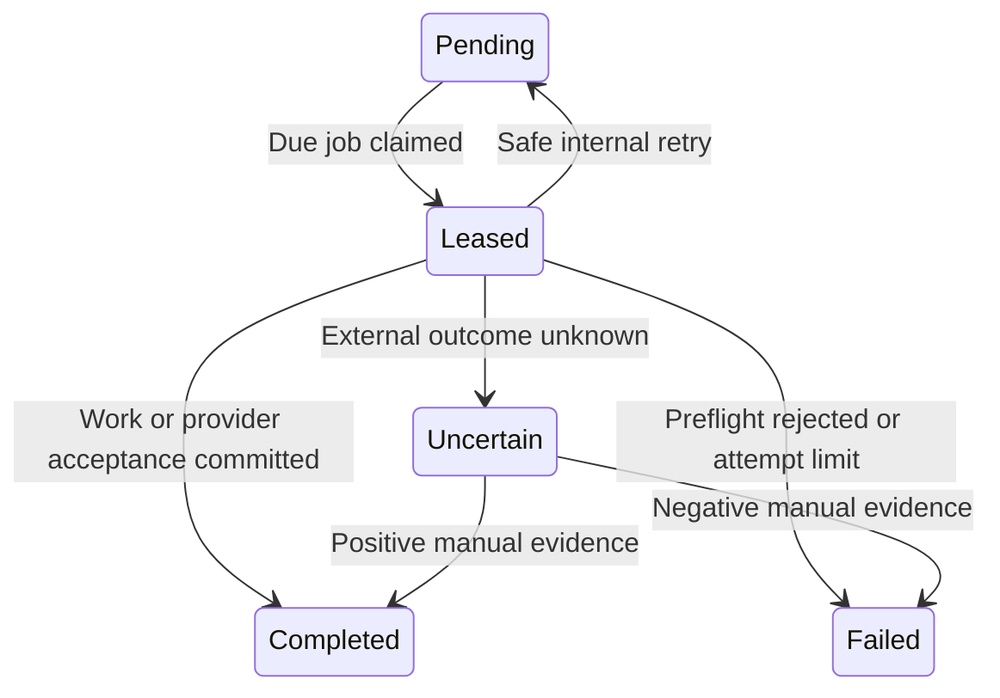

# Persistent jobs and external delivery

The .NET worker processes the PostgreSQL `Jobs` outbox. Business mutations create their jobs inside the same database transaction as the changed records. The worker does not require an in-memory queue to survive a restart. This document describes the implementation in `src/FirstBlick.Infrastructure/OutboxProcessor.cs` and `src/FirstBlick.Worker`.

## States and recovery

| State | Meaning | Automatic action |
|---|---|---|
| `Pending` | Work is eligible at `AvailableAt`; no external attempt has begun | A worker can claim it when due |
| `Leased` | A worker owns a random lease token until the database deadline | Only that token can mark or finish the attempt while the lease remains valid |
| `Completed` | Internal work completed, or the configured SMTP adapter returned successful acceptance | No automatic replay |
| `Failed` | A permanent preflight/configuration failure, exhausted safe attempts, or an explicitly reconciled negative result | No automatic replay |
| `Uncertain` | An external attempt may have been accepted, but its outcome cannot be committed reliably | Manual reconciliation; no automatic resend |



An expired lease is claimed with a new token. If `ExternalAttemptStarted` is false, the worker can safely retry the internal/preflight stage, subject to the attempt limit. If the flag is true, recovery moves the job to `Uncertain` without invoking the provider. A worker returning late with the old token cannot change the recovered result.

The claim uses one SQL statement containing `FOR UPDATE SKIP LOCKED` and `UPDATE ... RETURNING`. Concurrent workers skip rows already held by another transaction. This use matches PostgreSQL's documented queue-consumer application of [`SKIP LOCKED`](https://www.postgresql.org/docs/16/sql-select.html#SQL-FOR-UPDATE-SHARE); it is not used to provide a consistent general-purpose business query.

Lease validity and retry availability use `clock_timestamp()` from PostgreSQL. Preflight and completion each acquire the same transaction-level tenant advisory lock as API mutations:

```sql
SELECT pg_advisory_xact_lock(hashtextextended(tenant_id_as_string, 0));
```

Within those transactions, job ownership is checked by ID, tenant, random token, `Leased` state and an unexpired deadline. Quote rows also use row locks and revision checks. The worker commits `ExternalAttemptStarted = true` before calling SMTP and renews the lease for the bounded send stage. No database transaction or tenant lock is held during the network call. This permits a legitimate quote acceptance or another tenant mutation while transport is in progress.

Every transport exception, cancellation, invalid acceptance reference or timeout after the marker is treated conservatively as `Uncertain`. A disconnect can occur after a provider accepted a message. The implementation does not claim exactly-once email delivery. Successful SMTP submission is also distinct from arrival in a recipient's inbox or a read receipt.

On completion, the worker reloads the latest quote. It updates the delivery history and the stored/JSON quote revision together with the job outcome in one transaction. It preserves the quote's contractual status and acceptance timestamp. The job's original `EntityRevision` does not block an otherwise valid completion after a concurrent acceptance. If the frozen snapshot or delivery evidence is unavailable after an external attempt, the job remains `Uncertain`; corrupted evidence is not repaired by inventing a successful result.

## Implemented job types

| Type | Actual work and preflight checks |
|---|---|
| `entity.changed` | Completes an internal change marker. It currently has no additional external subscriber, search index or webhook side effect. |
| `quote.delivery` | Sends a plain-text representation of the immutable sales snapshot by email. Requires current active membership, quote-write permission, the commercial module, an issued/accepted unarchived quote, an unchanged snapshot digest and the matching queued delivery ID/channel/recipient. |
| `identity.recovery` | Decrypts the protected reset message, verifies current active tenant membership, unchanged confirmed email and the current Identity password-reset token, then sends a recovery link. |
| `notification.daily` | Builds a current, role-filtered morning email from the recipient's preferences, own assignments, own recorded time and any maintenance summary they are allowed to read. |

Quote emails contain line descriptions, quantities, selling prices, explicit tax amounts, totals and the supplied validity date. Internal material costs, labor rates and markup calculations are not included. This adapter does not generate a PDF attachment.

Only the email channel has a transport implementation. Push and WhatsApp jobs fail with `channel_unconfigured`. Unknown job types, including unimplemented `invoice.generate` or `document.generate`, fail with `unsupported_job_type`. They do not create a placeholder document or a misleading completed status.

### Identity recovery

The payload is encrypted with ASP.NET Core Data Protection purpose `FirstBlick.Identity.Recovery.v1`. Its protected contents are `{ email, token, userId }`. Reset-purpose tokens cannot be substituted with email-confirmation tokens, and changing the account's security stamp invalidates a queued token.

API and worker share the same database key ring and application name `FirstBlick`. Outside `Development` and `Testing`, the worker requires the configured PFX certificate with its RSA private key. The database key ring and certificate must both be recoverable after a host replacement. [Microsoft's Data Protection configuration documentation](https://learn.microsoft.com/en-us/aspnet/core/security/data-protection/configuration/overview?view=aspnetcore-10.0) describes database persistence, certificate protection and matching application names for shared payloads.

The email uses only the operator's configured `App:BaseUrl`; a requester cannot supply a destination URL. HTTPS is required outside development/testing. Local HTTP is allowed only for loopback URLs in those environments. The link carries `reset-email` and `reset-token` in its fragment. The client consumes and clears the fragment before routing or making API requests. The worker does not expose a reset token through a response, job list or log message.

### Daily notifications

The scheduler checks preferences at most once per minute in each worker process. It inserts a receipt and a job in one tenant transaction. The unique receipt key includes tenant, user, local calendar date and channel, so concurrent schedulers create one occurrence per channel. The preference is reloaded before sending; disabling a channel, morning briefings or membership prevents the queued send.

Due time and weekday use the preference's named time zone. An outage can be caught up later on the same local day. The scheduler does not backfill previous calendar days, and a queued occurrence from a previous local day fails preflight. During a daylight-saving clock repetition, the local-date receipt still prevents a second occurrence.

Assignment and time summaries use only active employee records linked to the recipient in the current tenant. Time totals subtract the overlapping portions of recorded breaks. Maintenance details require the recipient's current permission to read maintenance contracts. Disabled business modules and revoked roles are checked again at dispatch. The worker never broadens a recipient's visibility because the scheduler itself can enumerate tenants.

Each source collection is bounded to 10,000 records, the email displays at most 30 assignments and 20 maintenance items, and the message body is bounded to 2 MiB. An invalid or ambiguous midnight boundary in a time zone fails with `briefing_timezone_boundary_unsupported` when yesterday's time summary is requested; the implementation does not silently choose one interpretation. Ordinary European daylight-saving changes are supported because their local midnight boundaries remain unambiguous.

## Configuration and operation

Apply the database migration before starting the worker. Use the same database and Data Protection settings as the API. The worker does not run schema migrations automatically.

| Configuration key | Behavior |
|---|---|
| `ConnectionStrings:Database` | Required PostgreSQL connection string |
| `App:BaseUrl` | Public application address used for recovery links |
| `DataProtection:CertificatePath` | Required PFX file outside development/testing |
| `DataProtection:CertificatePassword` | PFX password, when applicable; supply through the deployment's secret mechanism |
| `Smtp:Host`, `Smtp:From` | Required to enable SMTP; `From` must be one plain email address |
| `Smtp:Port` | Defaults to `587`; port `465` is rejected because this adapter does not implement implicit TLS |
| `Smtp:Username`, `Smtp:Password` | Optional explicit SMTP credentials; operating-system default credentials are not used |
| `Smtp:EnableSsl` | STARTTLS remains required; setting this to `false` disables the configured adapter |
| `Outbox:LeaseSeconds` | Default `120`, allowed `30`–`600` |
| `Outbox:SendTimeoutSeconds` | Default `30`, allowed `1`–`120`; lease must exceed this by more than 10 seconds |
| `Outbox:MaximumAttempts` | Default `5`, allowed `1`–`20` |

The adapter uses `System.Net.Mail.SmtpClient` with `EnableSsl = true`. Its supported transport is STARTTLS; implicit TLS and OAuth SMTP are not implemented. The [official .NET API documentation](https://learn.microsoft.com/en-us/dotnet/api/system.net.mail.smtpclient.enablessl?view=net-10.0) describes these transport constraints. The submitted Message-ID is derived from the job ID and sender domain. `smtp-message-id:...` is an application-supplied correlation reference, not a provider-issued delivery receipt or provider deduplication guarantee.

Missing SMTP configuration makes external jobs explicitly `Failed` with `provider_unconfigured`. Installing provider settings later does not replay those failed jobs automatically. A new quote-delivery request or a new recovery request is required. A pre-marker transient internal error schedules a retry after 5, 10, 20, ... seconds, capped at 300 seconds and at the configured attempt count. Attempts after an already-started external marker are never retried as sends.

The host processes one job at a time per instance, waits two seconds when idle, and retries an unavailable poll after five seconds. Additional instances can consume the same queue. Each job gets a fresh dependency-injection scope. This implementation has no separate queue broker, provider webhook consumer, automatic SMTP receipt lookup, heartbeat during transport, automatic job retention purge or production throughput claim.

External job payloads are limited to 64 KiB before processing. Quote JSON remains under the application's 1,900,000-byte safety budget. Worker application logs contain only job IDs and bounded error codes, never plaintext payloads, recipient addresses, email bodies or reset tokens. The management job listing omits the payload.

## Manual reconciliation

Managing directors can inspect their tenant's jobs at `GET /api/v1/jobs`. An uncertain job can be resolved with `POST /api/v1/jobs/{id}/resolve`, supplying `delivered`, a concrete `evidence` note and any `providerReference`. The normal authenticated tenant, antiforgery and command-idempotency requirements apply. The action is audited; it does not call SMTP again.

Reconcile only after examining an actual provider record or other reliable evidence. A positive resolution records completion; a confirmed negative resolution records failure and, for a quote, releases the unresolved-delivery guard so a new explicit request can be made. When quote evidence itself is corrupted or missing, the data problem must first be repaired through a separately reviewed recovery procedure. Resetting `Uncertain` directly to `Pending` would discard the duplicate-send protection and is not a supported operation.

## Verification

`tests/FirstBlick.Api.Tests/WorkerTests.cs` uses actual PostgreSQL and an injected synthetic email sender. It creates a uniquely named `firstblick_test_worker_*` database per test and checks that prefix before teardown. Set `FIRSTBLICK_TEST_POSTGRES` to an isolated test server whose test role can create databases. Without that variable, the PostgreSQL tests are explicitly skipped; SQLite cannot establish these locking guarantees.

The tests exercise concurrent claims with a locked row, expired-token rejection, attempt limits, provider configuration failures, unsupported document jobs, current membership/role/module/snapshot checks, cross-tenant IDs, durable markers, quote acceptance during transport, late completion after lease recovery, missing evidence, safe backoff, shared persistent encryption keys, token-purpose/stamp invalidation, concurrent daily scheduling and recipient privacy. Worker tests use `EnsureCreated` for their isolated schema; the separate API suite is responsible for migration verification. No real SMTP message or production-provider acceptance is exercised by this suite.
